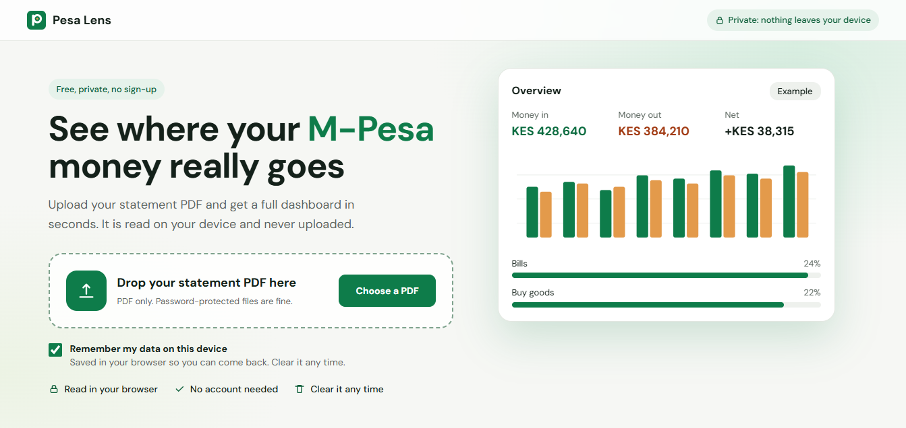
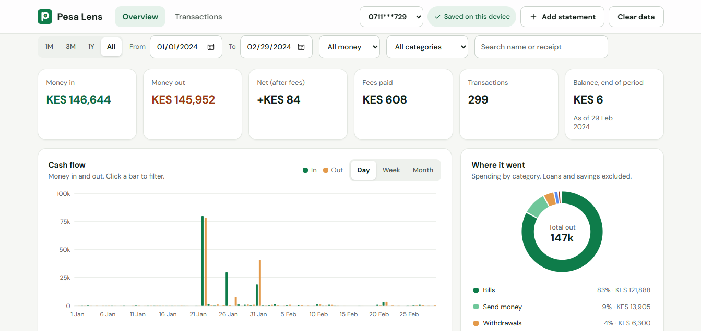

# Pesa Lens

A privacy-first M-Pesa dashboard that reads your statement PDF directly in the browser and turns it into a clear, filterable spending overview.

## What it does

- Upload an M-Pesa statement PDF, including password-protected ones
- Parse transactions locally in the browser with no upload to a server
- Group spending by category, date and type
- Show cash-flow summaries, totals and transaction trends
- Save data on-device with IndexedDB and clear it anytime

## Why it exists

Pesa Lens is built for people who want to understand where their money goes without handing their statements to a third party. Everything stays on the device unless you choose to clear it.

## Screenshots

## Tech notes

- Frontend: Next.js + TypeScript
- PDF parsing happens in-browser
- Data is kept in memory as the source of truth
- Optional persistence uses IndexedDB for local storage
- No server, API routes or user accounts

## Todo

- [ ] Improve PDF parsing accuracy for more statement layouts
- [ ] Add more category customization
- [ ] Improve mobile responsiveness and small-screen(xs) UX
- [ ] Add onboarding/tutorial to direct users on how it works

